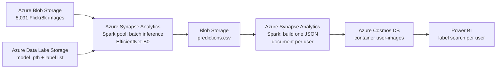
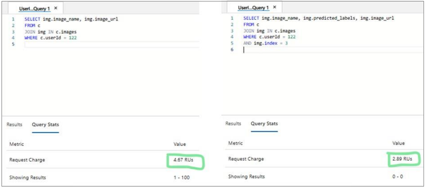

# Azure Image Classifier

Multi-label image classification and per-user label search on Azure, from a PyTorch model to Synapse batch inference, Cosmos DB and a Power BI frontend.

## What This Does

Social media platforms receive millions of images every day, and users expect to find their own pictures by content ("dog", "beach", "bike"). This project builds a prototype for that: a deep learning model automatically tags images with descriptive labels, the labels are stored per user in Azure Cosmos DB, and a Power BI dashboard lets each user search their own images by label.

University project. I led the project and worked in depth on all three main parts: the ML model, the Synapse pipeline and the Power BI frontend.

## Architecture



1. **Model training (local, PyTorch):** Labels are derived from the five captions per image, and an EfficientNet-B0 is fine-tuned for multi-label classification.
2. **Batch inference (Synapse Spark):** The trained model is loaded from Data Lake Storage. All images in the storage container get labelled, and the results are written to `predictions.csv`.
3. **User documents (Synapse Spark to Cosmos DB):** For the load test, 1,000 users with 3,000 images each are simulated. That gives 3 million image entries, stored as one JSON document per user.
4. **Frontend (Power BI):** The dashboard reads from Cosmos DB, and each user can only search their own images (filter by `userId` and label).

## Tech Stack

- **Machine learning:** PyTorch, torchvision (EfficientNet-B0, ImageNet weights), scikit-learn
- **Data preparation:** pandas, NumPy, Matplotlib
- **Cloud:** Azure Blob Storage, Azure Data Lake Storage Gen2, Azure Synapse Analytics (Spark pool), Azure Cosmos DB (NoSQL API)
- **Frontend:** Power BI
- **Dataset:** [Flickr8k](https://www.kaggle.com/datasets/adityajn105/flickr8k) (8,091 images, 5 captions each)

## How It Works

### 1. Labels from captions: `01_caption_exploration.ipynb`

Flickr8k ships captions, not labels. The exploration notebook cleans the 40,455 captions, tokenizes them and selects the **100 most frequent content tokens** (for example `dog`, `man`, `white`, `grass`) as the label vocabulary. The five captions of each image are merged, so every image ends up with a set of labels.

### 2. Multi-label model: `02_model_training.ipynb`

| Item | Value |
|---|---|
| Backbone | EfficientNet-B0, pretrained on ImageNet (transfer learning) |
| Head | Global average pooling, linear layer (1280 to 100), sigmoid |
| Loss / optimizer | Binary cross-entropy / Adam (lr = 1e-4), 20 epochs |
| Split | 5,824 train / 648 validation / 1,619 test images |

Every label gets its own probability, so one image can have several labels. Instead of keeping the default threshold of 0.5, I tuned the decision threshold on the test set:

| Threshold | Precision | Recall | F1 (micro) |
|---|---|---|---|
| 0.50 (default) | 0.538 | 0.363 | 0.433 |
| **0.25 (chosen)** | 0.410 | 0.517 | **0.457** |

The lower threshold trades a little precision for clearly higher recall. For image search that is the better choice, because a missing label means an image is never found.

The score has to be read in context: the model predicts 100 labels at once, and the labels are weak labels taken from free-text captions. Captions rarely mention everything in a picture, so many correct predictions (for example "grass" on a dog photo) count as false positives, and generic tokens such as colours or "two" are hard to predict from pixels alone. The example predictions in `02_model_training.ipynb` show that the labels are mostly plausible even where they differ from the captions.

### 3. Pipeline on Azure: [`docs/`](docs/)

- [`docs/01-batch-inference-synapse.md`](docs/01-batch-inference-synapse.md): load the model in a Synapse Spark pool, label all images from Blob Storage, write `predictions.csv`
- [`docs/02-synapse-to-cosmos-db.md`](docs/02-synapse-to-cosmos-db.md): simulate users, group images into one JSON document per user, write it to Cosmos DB

Example of a user document in Cosmos DB:

```json
{
  "id": "1",
  "userId": 1,
  "images": [
    {
      "image_name": "2692635048_16c279ff9e.jpg",
      "predicted_labels": "dog, black, brown, playing, ball, grass",
      "image_url": "https://<storage-account>.blob.core.windows.net/images/2692635048_16c279ff9e.jpg",
      "index": 1
    }
  ]
}
```

### 4. Label search and query cost

Because each user is one document, a search only has to read that user's document. Example queries in Cosmos DB (user 122):

```sql
-- all images of a user
SELECT img.image_name, img.image_url
FROM c
JOIN img IN c.images
WHERE c.userId = 122

-- one specific image of a user
SELECT img.image_name, img.predicted_labels, img.image_url
FROM c
JOIN img IN c.images
WHERE c.userId = 122 AND img.index = 3
```

Measured cost in the Cosmos DB Data Explorer: **4.67 RUs** for the first query and **2.89 RUs** for the second.



## Repository Structure

```
├── 01_caption_exploration.ipynb     # caption cleaning, token statistics, label vocabulary
├── 02_model_training.ipynb          # training, evaluation, threshold tuning, example predictions
├── predictions_sample.csv           # first 20 predictions of the batch inference
├── dataset/
│   └── top_tokens_with_images.csv   # label vocabulary (training and Synapse pipeline)
├── docs/                            # step-by-step guides for the Azure pipeline
│   └── images/                      # screenshots (Cosmos DB query cost)
└── requirements.txt
```

Only code and small reference files are versioned. The images and captions come from Kaggle; the CSVs and the trained model (`model_multilabel_5.pth`) are created by the notebooks.

## Getting Started

```bash
git clone https://github.com/AliHamze266/Azure-Image-Classifier.git
cd Azure-Image-Classifier
pip install -r requirements.txt
```

1. Download the [Flickr8k dataset from Kaggle](https://www.kaggle.com/datasets/adityajn105/flickr8k). Put `captions.txt` into the project root and the images into `dataset/Images/`. Neither is part of this repository because of their size (about 1.1 GB) and their licence.
2. Run `01_caption_exploration.ipynb`. It creates `dataset/captions.csv` and the other CSVs the training needs.
3. Run `02_model_training.ipynb` to train and evaluate the model. It runs on CPU, CUDA or Apple Silicon (MPS) and saves the weights as `model_multilabel_5.pth`.
4. To rebuild the Azure pipeline, follow the guides in [`docs/`](docs/). You need your own Azure resources; the original resources of the project have been deleted.

## What I Learned

- **Leading a data project:** splitting a big data use case into work packages, coordinating the work packages and still working hands-on in every layer
- **Transfer learning for multi-label problems:** sigmoid + binary cross-entropy instead of softmax, and why micro F1 is a better metric than accuracy here
- **Threshold tuning:** the decision threshold is a product decision, not just a model parameter (recall matters more for search)
- **Weak labels:** deriving training labels from free-text captions with tokenization and frequency analysis
- **Spark on Azure Synapse:** moving files between `abfss://`, `wasbs://` and the local node file system so that PyTorch can read them
- **Data modelling for NoSQL:** designing one document per user in Cosmos DB, so that the label search stays within a single user's data
- **Secrets handling:** access keys do not belong in code or documents; the guides in this repository use placeholders

## Future Ideas

- [ ] Distribute the batch inference across the Spark cluster (pandas UDF / `mapPartitions`) instead of a loop on the driver
- [ ] Store access keys in Azure Key Vault or use a managed identity instead of account keys
- [ ] Trigger labelling automatically for new uploads (Event Grid + Azure Functions)
- [ ] Tune the threshold on the validation set instead of the test set, so the test score stays unbiased
- [ ] Use a label vocabulary with fewer generic tokens (for example drop colours or stop-like words) and tune the threshold per label
- [ ] Compare with Azure AI Vision image tagging as a managed baseline

## License

University project, shared for portfolio purposes. The Flickr8k images and captions belong to their respective owners.
